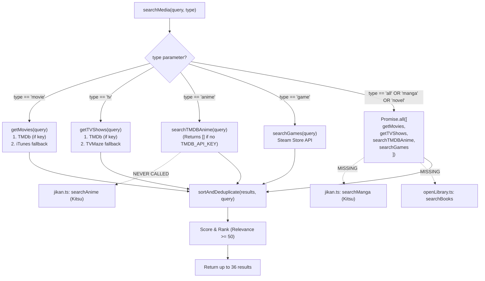
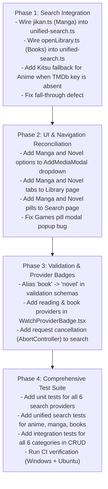

# Milestone 3 — Six Media Categories Audit Report

**Date:** 2026-11-19  
**Status:** Audit Investigation Complete (Feature Implementation NOT Started)  
**Repository:** AryanTechie-007/MLocker  
**Target Milestone:** Milestone 3 — Six Media Categories Expansion & Unified Search  
**Operating Constraint:** Investigation only. Zero application source code modifications.

---

## 1. Executive Summary

An exhaustive, evidence-based source-code audit was conducted across the entire MLocker repository to determine the current state of support for all six first-class media categories: **Movies**, **TV Shows**, **Anime**, **Manga**, **Games**, and **Books / Novels**.

### Key Findings at a Glance
1. **Naming & Taxonomy Discrepancy:** The architecture guideline (`.agents/skills/mlocker-architecture/SKILL.md:77-85`) specifies uppercase identifiers (`MOVIE`, `TV_SHOW`, `ANIME`, `MANGA`, `GAME`, `BOOK`), but the actual runtime implementation across database schemas, Prisma models, domain validation, API routes, and UI components uses lowercase identifiers (`"movie"`, `"tv"`, `"anime"`, `"manga"`, `"game"`, `"novel"`).
2. **Book vs. Novel Identification:** The fifth and sixth media categories are handled inconsistently:
   - The database, Prisma schema, domain validation, and API routes treat `"novel"` as the canonical identifier.
   - The UI labels it `"Novels & Books"`.
   - The architecture skill references `BOOK`.
   - An ad-hoc database test (`tests/database/legacy-compatibility.test.ts:522`) inserted `"book"` directly into SQLite.
3. **Orphaned Search Providers:**
   - `src/lib/api/jikan.ts` implements both `searchAnime` and `searchManga` against Kitsu API, but it is **completely disconnected** from `unified-search.ts`.
   - `src/lib/api/openLibrary.ts` implements `searchBooks` against Open Library, returning `mediaType: "novel"`, but is also **completely disconnected** from `unified-search.ts`.
   - As a result, searching for Manga or Novels/Books falls through to a search for Movies, TV Shows, Anime, and Games!
4. **Fragile Anime Search:** `unified-search.ts` delegates anime queries exclusively to TMDb (`searchTMDBAnime`), which requires `TMDB_API_KEY`. If this key is absent, anime search returns empty arrays with zero fallback, even though an unauthenticated Kitsu anime search already exists in `jikan.ts`.
5. **UI Gaps for Manga and Books:**
   - `src/components/AddMediaModal.tsx:226-230`: The manual entry `<select>` dropdown omits both `manga` and `novel`. A user cannot manually create manga or books.
   - `src/app/library/page.tsx:110-116`: Category tabs only show `All Vaults`, `Movies`, `TV Shows`, `Anime`, and `Games`. There are no tabs for `Manga` or `Novels`.
   - `src/app/search/page.tsx:31-37`: Search category pills omit `manga` and `novel`.
6. **Progress Tracking Incompleteness:**
   - Books and Novels only have `readChapters` and `totalChapters` in the database. Page tracking (`readPages`, `totalPages`) does not exist in `prisma/schema.prisma`.
   - TV Shows lack season-level tracking (`totalSeasons`, `currentSeason`).
7. **Test Coverage Gaps:**
   - Existing search tests in `tests/unit/unified-search.test.ts` only test `movie`, `tv`, and `game`. There are **zero** search tests for `anime`, `manga`, or `novel`.

---

## 2. Actual Architecture & Data Model

MLocker’s media data model is centered around the `UserMedia` table in SQLite (Desktop) and PostgreSQL (Cloud), defined in `prisma/schema.prisma` lines 21–61 and instantiated via `prisma/migrations/20261119000000_init/migration.sql`.

```
┌─────────────────────────────────────────────────────────────────────────────────┐
│                                   UserMedia                                     │
├───────────────────┬─────────────────────────┬───────────────────────────────────┤
│ Column            │ SQLite Type             │ Prisma Definition                 │
├───────────────────┼─────────────────────────┼───────────────────────────────────┤
│ id                │ TEXT PRIMARY KEY        │ String @id @default(cuid())       │
│ userId            │ TEXT NOT NULL           │ String                            │
│ mediaType         │ TEXT NOT NULL           │ String                            │
│ externalId        │ TEXT                    │ String?                           │
│ externalSource    │ TEXT                    │ String?                           │
│ title             │ TEXT NOT NULL           │ String                            │
│ posterUrl         │ TEXT                    │ String?                           │
│ year              │ INTEGER                 │ Int?                              │
│ genres            │ TEXT (JSON string array)│ String?                           │
│ overview          │ TEXT                    │ String?                           │
│ status            │ TEXT NOT NULL           │ String @default("plan_to_consume")│
│ rating            │ REAL                    │ Float? (0-10)                     │
│ review            │ TEXT                    │ String?                           │
│ isFavorite        │ BOOLEAN NOT NULL        │ Boolean @default(false)           │
│ totalEpisodes     │ INTEGER                 │ Int?                              │
│ watchedEpisodes   │ INTEGER                 │ Int?                              │
│ totalChapters     │ INTEGER                 │ Int?                              │
│ readChapters      │ INTEGER                 │ Int?                              │
│ hoursPlayed       │ REAL                    │ Float?                            │
│ startDate         │ DATETIME                │ DateTime?                         │
│ endDate           │ DATETIME                │ DateTime?                         │
│ tags              │ TEXT (JSON string array)│ String?                           │
│ createdAt         │ DATETIME NOT NULL       │ DateTime @default(now())          │
│ updatedAt         │ DATETIME NOT NULL       │ DateTime @updatedAt               │
└───────────────────┴─────────────────────────┴───────────────────────────────────┘
```

### Relational Constraints and Indexes
- Primary Key: `id`
- Unique Compound Constraint: `@@unique([userId, mediaType, externalId])` (`prisma/schema.prisma:58`)
- Compound Indexes:
  - `@@index([userId, mediaType])` (`prisma/schema.prisma:59`)
  - `@@index([userId, status])` (`prisma/schema.prisma:60`)
- Foreign Key: `CONSTRAINT UserMedia_userId_fkey FOREIGN KEY (userId) REFERENCES User(id) ON DELETE CASCADE ON UPDATE CASCADE`

### Pure Domain Schemas (`src/lib/domain/validation.ts`)
- `MEDIA_TYPES`: `["movie", "tv", "anime", "manga", "game", "novel"] as const` (`src/lib/domain/validation.ts:9-16`)
- `MEDIA_STATUSES`: `["plan_to_consume", "in_progress", "completed", "on_hold", "dropped"] as const` (`src/lib/domain/validation.ts:18-24`)
- `MediaTypeEnum`: `z.enum(MEDIA_TYPES)` (`src/lib/domain/validation.ts:26`)
- `CreateMediaSchema`: Enforces required `mediaType`, `title`, bounds on `rating` (0–10), and non-negative integers for progress fields (`src/lib/domain/validation.ts:58-77`).

---

## 3. Six-Category Support Matrix

The table below details the exact implementation status across all subsystems for each of the six categories:

| Category | Canonical Identifier | DB Schema (`UserMedia`) | External Search Integration | Manual Entry Modal | CRUD API Handling | Navigation & Filters | Progress Tracking Metric | Automated Test Coverage |
|---|---|---|---|---|---|---|---|---|
| **Movies** | `movie` | **Complete** (`mediaType: "movie"`) | **Complete** (TMDb primary, iTunes fallback) | **Complete** (Selectable option) | **Complete** (POST, GET, PATCH, DELETE) | **Complete** (Tabs, Vaults, Badges) | Binary status only (`plan_to_consume` → `completed`) | **Comprehensive** (Unit & Security) |
| **TV Shows** | `tv` | **Complete** (`mediaType: "tv"`) | **Complete** (TMDb primary, TVMaze fallback) | **Complete** (Selectable option) | **Complete** (`watchedEpisodes`, `totalEpisodes`) | **Complete** (Tabs, Vaults, Badges) | Episode counts (`watchedEpisodes` / `totalEpisodes`) | **Partial** (Validation tests, basic unit) |
| **Anime** | `anime` | **Complete** (`mediaType: "anime"`) | **Fragile** (TMDb only; fails without API key; Kitsu orphaned) | **Complete** (Selectable option) | **Complete** (`watchedEpisodes`, `totalEpisodes`) | **Complete** (Tabs, Vaults, Badges, Streaming links) | Episode counts (`watchedEpisodes` / `totalEpisodes`) | **Minimal** (Validation enum test only) |
| **Manga** | `manga` | **Complete** (`mediaType: "manga"`) | **Broken** (Omitted in `unified-search.ts`; Kitsu orphaned) | **Broken** (Omitted from category dropdown) | **Functional** (Domain schema supports it) | **Broken** (Omitted from library tabs & search pills) | Chapter counts (`readChapters` / `totalChapters`) | **Minimal** (One negative boundary test) |
| **Games** | `game` | **Complete** (`mediaType: "game"`) | **Functional** (Steam Store + AppDetails API) | **Complete** (Selectable option) | **Complete** (`hoursPlayed`) | **Functional** (Tabs exist; search pill triggers modal) | Hours played (`hoursPlayed` Float) | **Partial** (Score tests, boundary tests) |
| **Books / Novels** | `novel` | **Complete** (`mediaType: "novel"`) | **Broken** (Omitted in `unified-search.ts`; OpenLibrary orphaned) | **Broken** (Omitted from category dropdown) | **Functional** (Domain schema supports it) | **Broken** (Omitted from library tabs & search pills) | Chapter counts only (`readChapters` / `totalChapters`) | **Minimal** (Empty title test only) |

---

## 4. Database and Enum Findings

### 4.1 Uppercase vs. Lowercase vs. Mixed Conventions
- **Architectural Specification:** `.agents/skills/mlocker-architecture/SKILL.md:77-85` documents `MOVIE`, `TV_SHOW`, `ANIME`, `MANGA`, `GAME`, `BOOK`.
- **Runtime Reality:** The database, Prisma schema, domain validation, and frontend components use exclusively lowercase: `"movie"`, `"tv"`, `"anime"`, `"manga"`, `"game"`, `"novel"`.
- **Recommendation:** **Retain lowercase at the runtime and database level.** Changing existing SQLite records to uppercase would constitute a breaking database migration and require updating dozens of frontend component conditionals. The architectural skill should be reconciled to acknowledge the canonical lowercase runtime representation.

### 4.2 Investigation of `BOOK` vs. `NOVEL` vs. `BOOKS`
1. **Schema & Code Truth:**
   - `prisma/schema.prisma:27`: comment states `// "movie" | "tv" | "anime" | "manga" | "game" | "novel"`
   - `src/lib/domain/validation.ts:15`: explicitly defines `"novel"`
   - `src/lib/api/types.ts:1`: explicitly defines `"novel"`
   - `src/lib/api/openLibrary.ts:33`: sets `mediaType: "novel"`
   - `src/app/page.tsx:416`: labels `"novel"` as `"Novels & Books"`
   - `src/app/stats/page.tsx:129`: aggregates stats for `"novel"`
2. **Where `book` appears:**
   - `tests/database/legacy-compatibility.test.ts:522`: `db.prepare("INSERT INTO UserMedia (..., mediaType, ...) VALUES (..., 'book', ...)").run()` was used as an ad-hoc test value.
   - Descriptive copy in `src/app/collections/page.tsx:210`, `src/app/search/page.tsx:471`, `src/components/AddMediaModal.tsx:164`.
3. **Reconciliation Strategy:**
   - Canonical DB representation remains `"novel"` (or aliased transparently).
   - In `src/lib/domain/validation.ts`, `MediaTypeEnum` can accept either `"novel"` or `"book"` and normalize to `"novel"` (e.g. `z.preprocess(...)` or `z.enum([...]).transform(...)`), or maintain `"novel"` internally while presenting "Books & Novels" in the UI.

### 4.3 SQLite vs. PostgreSQL Considerations
- **SQLite (Desktop):** `mediaType` is defined as `TEXT NOT NULL` in `prisma/migrations/20261119000000_init/migration.sql:15`. SQLite enforces **no check constraints** on `mediaType`. Any string can technically be inserted via direct SQLite drivers.
- **PostgreSQL (Cloud):** In PostgreSQL, `mediaType` will be mapped to `TEXT NOT NULL`. If Prisma ORM native enums are ever introduced, a migration will be required to create a PostgreSQL enum type.
- **What happens on unexpected string insertion?**
  - Via direct DB: Insert succeeds.
  - Via API (`POST /api/media`): `CreateMediaSchema` rejects the request with HTTP 400 (`Invalid enum value. Expected 'movie' | 'tv' | 'anime' | 'manga' | 'game' | 'novel'`).
  - Via `GET /api/stats`: Items with unrecognized strings are ignored in `mediaTypeCounts` and `statusByType` because keys are checked against known maps (`src/app/api/stats/route.ts:67-69`).
  - In `MediaCard.tsx`: Falls through to `default:` in `getTypeIcon()` (`src/components/MediaCard.tsx:38`), displaying the `Film` icon.

---

## 5. Search Provider and Unified Search Findings

### 5.1 Provider-by-Provider Breakdown

#### 1. TMDb Provider (`src/lib/api/tmdb.ts`)
- **Capabilities:** Movies (`searchTMDBMovies`), TV Shows (`searchTMDBTV`), Anime (`searchTMDBAnime`).
- **Authentication:** Requires `TMDB_API_KEY` via `process.env.TMDB_API_KEY`.
- **Anime Filtering Logic:** `searchTMDBAnime()` queries both TMDb `/search/tv` and `/search/movie`, then applies `checkIsAnime()` (checking `original_language === 'ja'`, Japanese studio names, or keyword matching).
- **Critical Vulnerability:** If `TMDB_API_KEY` is not set, `searchTMDBAnime()` immediately returns `[]` (`src/lib/api/tmdb.ts:432`). It does **not** fall back to any secondary provider.

#### 2. iTunes Movie Provider (`src/lib/api/itunes.ts`)
- **Capabilities:** Feature movies (`searchMovies`).
- **Authentication:** Zero API keys required.
- **Behavior:** Queries `itunes.apple.com/search`, filters by `kind === "feature-movie"`, upscales posters from 100x100 to 600x600, provides Apple TV direct links.
- **Status:** Stable, highly reliable fallback for Movies.

#### 3. TVMaze Provider (`src/lib/api/tvmaze.ts`)
- **Capabilities:** Television series (`searchTV`).
- **Authentication:** Zero API keys required.
- **Behavior:** Queries `api.tvmaze.com/search/shows`, strips HTML from summaries, resolves network/streaming names.
- **Status:** Stable, highly reliable fallback for TV Shows.

#### 4. Steam Store Provider (`src/lib/api/steam.ts`)
- **Capabilities:** Video games (`searchGames`).
- **Authentication:** Zero API keys required.
- **Behavior:** Queries `store.steampowered.com/api/storesearch/`, then performs secondary fetches to `store.steampowered.com/api/appdetails?appids=${id}` for top 8 results to retrieve release years, genres, and overviews. Generates storefront links for Steam, Epic Games, and GOG.
- **Status:** Functional, though secondary detail requests can introduce slight latency.

#### 5. Orphaned Kitsu / Jikan Provider (`src/lib/api/jikan.ts`)
- **Capabilities:** Anime (`searchAnime`) and Manga (`searchManga`).
- **Misnomer Note:** File is named `jikan.ts`, but the implementation completely queries the **Kitsu Edge API** (`kitsu.io/api/edge/anime` and `kitsu.io/api/edge/manga`).
- **Authentication:** Zero API keys required.
- **Output:** Returns canonical titles, large posters, release years, average ratings, episode counts (for anime), and chapter counts (for manga).
- **Status:** **ORPHANED.** Never imported into `unified-search.ts`.

#### 6. Orphaned Open Library Provider (`src/lib/api/openLibrary.ts`)
- **Capabilities:** Books / Novels (`searchBooks`).
- **Authentication:** Zero API keys required.
- **Output:** Queries `openlibrary.org/search.json`, parses cover images (`covers.openlibrary.org/b/id/...-L.jpg`), authors, subjects, and ratings. Emits `mediaType: "novel"`.
- **Status:** **ORPHANED.** Never imported into `unified-search.ts`.

### 5.2 Unified Search Execution Trace (`src/lib/api/unified-search.ts`)



#### The Fall-Through Defect
In `src/lib/api/unified-search.ts:84-110`:
```typescript
if (type === "movie") return sortAndDeduplicate(await getMovies(trimmed), trimmed);
if (type === "tv") return sortAndDeduplicate(await getTVShows(trimmed), trimmed);
if (type === "anime") return sortAndDeduplicate(await searchTMDBAnime(trimmed), trimmed);
if (type === "game") return sortAndDeduplicate(await searchGames(trimmed), trimmed);

// Fall-through for 'all', but ALSO executed for 'manga' and 'novel'!
const [movies, tvShows, anime, games] = await Promise.all([
  getMovies(trimmed),
  getTVShows(trimmed),
  searchTMDBAnime(trimmed),
  searchGames(trimmed),
]);
return sortAndDeduplicate([...movies, ...tvShows, ...anime, ...games], trimmed);
```
When a client requests `GET /api/search?q=berserk&type=manga`, `searchMedia` does not match `"movie"`, `"tv"`, `"anime"`, or `"game"`. It executes the 4-way parallel search for movies, tv, anime, and games!

---

## 6. Manual Entry and CRUD Findings

### 6.1 Manual Entry Modal (`src/components/AddMediaModal.tsx`)
- **Category Dropdown Defect:** Lines 226–230 define:
  ```tsx
  <select value={mediaType} onChange={(e) => setMediaType(e.target.value)}>
    <option value="movie">Movie</option>
    <option value="tv">TV Series</option>
    <option value="anime">Anime (Crunchyroll, TV, Movie)</option>
    <option value="game">Video Game (PC, Steam, Epic)</option>
  </select>
  ```
  Neither `<option value="manga">` nor `<option value="novel">` is present.
- **Conditional Progress Fields:** Interestingly, lines 374–400 **already contain** the UI for Manga and Novels:
  ```tsx
  {(mediaType === "manga" || mediaType === "novel") && (
    <div>... Read Chapters / Total Chapters ...</div>
  )}
  ```
  However, because the user cannot select `manga` or `novel` from the dropdown, this block is unreachable in manual mode unless pre-filled by an external search result (which is also broken).

### 6.2 API Route Handling (`src/app/api/media/route.ts`)
- **Validation:** Relies on `CreateMediaSchema` (`src/lib/domain/validation.ts:58`). It accepts any valid `MediaTypeEnum` (`"movie"`, `"tv"`, `"anime"`, `"manga"`, `"game"`, `"novel"`).
- **Upsert / Deduplication:** Correctly enforces `userId_mediaType_externalId` uniqueness. If an item already exists with matching `userId`, `mediaType`, and `externalId`, it updates progress and status rather than duplicating (`src/app/api/media/route.ts:107-138`).
- **Data Sanitization:** Correctly sanitizes arrays for `genres` and `tags` using `JSON.stringify()`.

### 6.3 Update Modal (`src/components/EditMediaModal.tsx`)
- **Status Labels:** Accurately adapts the status labels based on `mediaType` (`src/components/EditMediaModal.tsx:248-264`):
  - Games: "Playing", "Plan to Play"
  - Manga / Novel: "Reading", "Plan to Read"
  - Movies / TV / Anime: "Watching", "Plan to Watch"
- **Progress Steppers:**
  - Games: Hours Played input.
  - Anime / TV: Episodes Watched input + `+1 Ep` quick increment button.
  - Manga / Novel: Chapters Read input + `+1 Ch` quick increment button.
  - Movies: No progress steppers (status and rating only).

---

## 7. Navigation, Filtering, and UI Findings

### 7.1 Dashboard (`src/app/page.tsx`)
- **Media Vaults Quick Access:** Lines 410–416 correctly display all 6 categories:
  - Movies: Film icon (`#8b5cf6`)
  - TV Series: Tv icon (`#38bdf8`)
  - Anime: Sparkles icon (`#ec4899`)
  - Manga: BookMarked icon (`#d946ef`)
  - Games: Gamepad2 icon (`#10b981`)
  - Novels & Books: BookOpen icon (`#f59e0b`)
- **Quick Logging Bar:** Lines 102–124 correctly increment episodes for TV/Anime, chapters for Manga/Novels, and hours for Games.

### 7.2 Library View (`src/app/library/page.tsx`)
- **Category Tabs Defect:** Lines 110–116 define:
  ```typescript
  const categoryTabs = [
    { type: "all", label: "All Vaults", icon: Layers },
    { type: "movie", label: "Movies", icon: Film },
    { type: "tv", label: "TV Shows", icon: Tv },
    { type: "anime", label: "Anime", icon: Sparkles },
    { type: "game", label: "Games", icon: Gamepad2 },
  ];
  ```
  Manga and Novels are missing. When a user navigates to `/library?type=manga` from the dashboard, items are filtered correctly by `item.mediaType === 'manga'`, but **no category tab is highlighted**, and the user cannot click back to Manga after switching tabs.

### 7.3 Search View (`src/app/search/page.tsx`)
- **Search Category Pills Defect:** Lines 31–37 define:
  ```typescript
  const categories = [
    { type: "all", label: "All Titles", icon: Layers },
    { type: "movie", label: "Movies", icon: Film },
    { type: "tv", label: "TV Shows", icon: Tv },
    { type: "anime", label: "Anime", icon: Sparkles },
    { type: "game", label: "Games", icon: Gamepad2 },
  ];
  ```
  Manga and Novels are omitted from the category filter bar.
- **Games Pill Click Bug:** In `src/app/search/page.tsx:160-162`:
  ```typescript
  onClick={() => {
    setActiveType(cat.type);
    if (cat.type === "game") {
      setIsManualModalOpen(true);
    }
  }}
  ```
  Clicking the "Games" filter pill immediately triggers the manual entry modal instead of filtering the search results to games!

### 7.4 Watch & Storefront Providers (`src/components/WatchProviderBadge.tsx`)
- **`getQuickSearchProviders(title, mediaType)`:**
  - Games: Steam, Epic Games, GOG, Xbox, PlayStation.
  - Anime: Crunchyroll, Netflix, HIDIVE, Hulu, Prime Video.
  - Default (Movies / TV): Crunchyroll, Netflix, Prime Video, Disney+, Max, Apple TV, Hulu.
  - Manga: **Missing.** Should support services such as MangaDex, Viz, Crunchyroll Manga, BookWalker.
  - Books: **Missing.** Should support Open Library, Goodreads, Google Books, Kindle.

---

## 8. Progress Tracking Findings

### 8.1 Existing Progress Attributes in Schema
- `totalEpisodes` (Int?): Applicable to TV Shows and Anime.
- `watchedEpisodes` (Int?): Applicable to TV Shows and Anime.
- `totalChapters` (Int?): Applicable to Manga and Novels.
- `readChapters` (Int?): Applicable to Manga and Novels.
- `hoursPlayed` (Float?): Applicable to Games.

### 8.2 Architectural Gaps in Progress Tracking
1. **Books / Novels (Page Tracking):**
   - In standard book tracking (e.g. Goodreads, StoryGraph), progress is measured in **pages** (`totalPages`, `readPages`) or percentage, rarely in chapters.
   - The current schema only supports `readChapters` and `totalChapters`.
   - A user tracking a 600-page book currently has to treat pages as "chapters" or leave progress blank.
2. **TV Shows (Season Tracking):**
   - The schema tracks cumulative episodes across all seasons (`totalEpisodes`, `watchedEpisodes`).
   - There are no fields for `currentSeason` or `seasonNumber`. While acceptable for an MVP tracker, it limits rich season-by-season progress.
3. **Manga (Volume Tracking):**
   - Manga is commonly collected and tracked by volumes (`totalVolumes`, `readVolumes`) in addition to chapters.
4. **Movies (Runtime Minutes):**
   - `SKILL.md:79` specifies "Runtime minutes / Watched status". The schema has no runtime field. Movies currently rely solely on binary status (`plan_to_consume`, `in_progress`, `completed`).

### 8.3 Safe Schema Extension Analysis
If new nullable columns are introduced (e.g., `totalPages Int?`, `readPages Int?`):
- It requires a versioned migration (e.g. `202611...`).
- The Electron embedded migrator and legacy schema validator (`electron/database/schema-validator.js`) must be updated to include the new columns in `BASELINE_COLUMNS` or define an explicit migration path from v1 to v2.
- Because the columns would be nullable with no default or with `DEFAULT 0`, existing databases would remain compatible without record loss.

---

## 9. Existing Test Coverage and Gaps

### 9.1 Existing Test Suite Inventory
- **Database (`tests/database/`):** 6 test suites covering migrations, legacy compatibility, WAL checkpoints, failure injection, and graceful shutdown.
- **Security (`tests/security/`):** 5 test suites covering tenant isolation, IDOR, Electron navigation, IPC bridge, and Zod domain validation.
- **Unit (`tests/unit/`):** 3 test suites:
  - `unified-search.test.ts`: Tests `normalizeString`, `calculateScore`, `sortAndDeduplicate`, and empty query handling.
  - `media-formatting.test.ts`: Tests HTML stripping, date parsing, iTunes image scaling.
  - `modal-state-reset.test.ts`: Tests React state synchronization on item change.

### 9.2 Comprehensive Coverage Gap Analysis
1. **Search Integration Testing:**
   - `tests/unit/unified-search.test.ts` uses mock movie items (`createMockItem("1", "Dune", "movie")`) for scoring tests.
   - **Zero tests exist** verifying that `searchMedia("...", "anime")`, `searchMedia("...", "manga")`, or `searchMedia("...", "novel")` dispatch to the correct providers.
   - **Zero tests exist** verifying fallback behavior (e.g. TMDb fails -> iTunes succeeds).
2. **Provider Unit Tests:**
   - No individual test files exist for `tmdb.ts`, `itunes.ts`, `tvmaze.ts`, `steam.ts`, `jikan.ts`, or `openLibrary.ts`.
3. **CRUD API Integration Tests:**
   - `tests/security/validation.test.ts` verifies that `CreateMediaSchema` validates payloads, but no tests verify that `/api/media` persists and returns all 6 categories properly.
4. **Progress Calculation Tests:**
   - No unit tests exist for progress percentage calculation logic across categories in `MediaCard.tsx` or `src/app/page.tsx`.

---

## 10. Security and Data-Integrity Considerations

1. **URL Protocol Enforcement:**
   - Poster URLs from search providers and manual entry are strictly validated by `SafeUrlSchema` (`src/lib/domain/validation.ts:35-43`), permitting only `http://` and `https://`.
   - External links in `WatchProviderBadge.tsx` use predefined HTTPS templates.
2. **SQL Injection Prevention:**
   - All database queries are executed via Prisma ORM parameterized statements or `better-sqlite3` prepared statements.
   - In `src/app/api/media/route.ts:59`, `sortBy` is strictly validated by `MediaQuerySchema` enum (`["updatedAt", "createdAt", "rating", "year", "title"]`), preventing dynamic SQL injection.
3. **Relational Tenant Isolation (IDOR Prevention):**
   - Media creation, retrieval, updates, and deletion enforce `where: { id, userId }`.
   - Cross-user tampering is verified by `tests/security/tenant-isolation.test.ts`.
4. **Input Boundary Enforcement:**
   - Ratings are strictly bounded to `[0, 10]`.
   - Progress fields are bounded to `[0, 100000]` and cannot be negative.
   - Title strings are trimmed and bounded to 500 characters.

---

## 11. Prioritized Implementation Recommendations

### Priority 1: High / Essential (Fix Core Functionality without Schema Changes)
1. **Connect Manga Search in `unified-search.ts`:**
   - Import `searchManga` from `src/lib/api/jikan.ts`.
   - Add `if (type === "manga") return sortAndDeduplicate(await searchManga(trimmed), trimmed);`.
   - Include `searchManga(trimmed)` in the `type === "all"` parallel search.
2. **Connect Books / Novels Search in `unified-search.ts`:**
   - Import `searchBooks` from `src/lib/api/openLibrary.ts`.
   - Add `if (type === "novel") return sortAndDeduplicate(await searchBooks(trimmed), trimmed);`.
   - Include `searchBooks(trimmed)` in the `type === "all"` parallel search.
3. **Add Anime Search Fallback:**
   - In `unified-search.ts`, wrap `searchTMDBAnime()` so that if `TMDB_API_KEY` is not present or if TMDb returns empty/fails, it falls back to `searchAnime` from `src/lib/api/jikan.ts` (Kitsu).
4. **Fix Manual Entry Dropdown (`src/components/AddMediaModal.tsx`):**
   - Add `<option value="manga">Manga</option>` and `<option value="novel">Novel / Book</option>` to the category `<select>`.
5. **Fix Library Category Tabs (`src/app/library/page.tsx`):**
   - Add `manga` (`BookMarked`) and `novel` (`BookOpen`) to `categoryTabs`.
6. **Fix Search Category Pills (`src/app/search/page.tsx`):**
   - Add `manga` and `novel` to search `categories`.
   - Remove the anomalous `setIsManualModalOpen(true)` popup when clicking the "Games" pill.

### Priority 2: Medium (Robustness & Polish)
7. **Search Debounce & AbortController:**
   - Add `AbortController` support to cancel in-flight search requests when the user types a new query.
8. **Add Reading & Book Providers to `WatchProviderBadge.tsx`:**
   - Add quick search links for Manga (MangaDex, Viz, BookWalker) and Books (Open Library, Goodreads, Google Books).
9. **Category Identifier Aliasing:**
   - Update `MediaTypeEnum` in `src/lib/domain/validation.ts` to accept `"book"` as an alias for `"novel"` via Zod transform, preserving backward compatibility while preventing errors if a client submits `"book"`.

### Priority 3: Low / Future Scope (Requires Schema Migration)
10. **Page Tracking for Books:**
    - If user desires page-level tracking, plan a versioned Prisma migration adding `totalPages Int?` and `readPages Int?` to `UserMedia`. Update Electron migrator accordingly.

---

## 12. Proposed Implementation Sequence



---

## 13. Acceptance Criteria & Required Regression Tests

### Acceptance Criteria
- [ ] Users can search across all six categories individually (`movie`, `tv`, `anime`, `manga`, `game`, `novel`) and unified (`all`).
- [ ] Anime search functions reliably even when `TMDB_API_KEY` is not configured.
- [ ] Users can manually create items for all six categories via `AddMediaModal`.
- [ ] Library navigation tabs display all six categories with accurate count badges and active states.
- [ ] Detail page renders correct metadata, progress steppers, and external links for all six categories.
- [ ] Zero regression on database migrations, legacy database validation, or Windows Electron shutdown.

### Required New Test Files & Cases
1. `tests/unit/unified-search-categories.test.ts`:
   - Test `searchMedia(query, "manga")` dispatches to Manga search.
   - Test `searchMedia(query, "novel")` dispatches to OpenLibrary search.
   - Test `searchMedia(query, "anime")` falls back to Kitsu when TMDb returns empty.
   - Test parallel unified search (`type === "all"`) aggregates results across all 6 categories.
2. `tests/unit/category-progress.test.ts`:
   - Test progress calculation and string formatting for all 6 media types.
3. `tests/security/category-crud.test.ts`:
   - Test manual creation, update, and deletion of all 6 media types via `/api/media`.

---

## 14. Files Likely to Require Modification During Implementation

| File Path | Nature of Change |
|---|---|
| `src/lib/api/unified-search.ts` | Import `searchManga` and `searchBooks`; add branches for `manga` and `novel`; add Kitsu fallback for anime; update parallel search. |
| `src/components/AddMediaModal.tsx` | Add `manga` and `novel` `<option>` elements to the category select dropdown. |
| `src/app/library/page.tsx` | Add `manga` and `novel` items to `categoryTabs` with `BookMarked` and `BookOpen` icons. |
| `src/app/search/page.tsx` | Add `manga` and `novel` to search `categories`; remove `setIsManualModalOpen(true)` from the `game` pill handler. |
| `src/components/WatchProviderBadge.tsx` | Add quick search providers for manga (MangaDex, Viz) and books (Open Library, Goodreads, Google Books). |
| `src/lib/domain/validation.ts` | (Optional) Alias `"book"` to `"novel"` in `CreateMediaSchema` / `MediaQuerySchema`. |
| `tests/unit/unified-search.test.ts` | Add test coverage for anime, manga, and novel search dispatching and ranking. |
| `implementation-plan.md` | Update Milestone 3 tasks and status upon authorization. |

---

## 15. Risks, Unresolved Questions & Decisions Requiring Approval

Before beginning any code changes for Milestone 3, the following decisions must be reviewed and approved:

### Decision 1: Canonical Internal Identifier (`novel` vs. `book`)
- **Option A (Recommended):** Retain `"novel"` as the internal database string (100% backward compatible with existing SQLite databases, Prisma schema, and test fixtures), present it as **"Novels & Books"** in the UI, and accept either `"novel"` or `"book"` in API validation (auto-normalizing to `"novel"`).
- **Option B:** Migrate database column values and schemas from `"novel"` to `"book"`. *(Risk: Requires creating a new Prisma migration and updating existing test databases).*

### Decision 2: Progress Tracking Scope for Books (Chapters vs. Pages)
- **Option A (Recommended for Milestone 3):** Retain the existing `totalChapters` / `readChapters` fields for books in Milestone 3 without changing the database schema.
- **Option B:** Add `totalPages Int?` and `readPages Int?` to `prisma/schema.prisma`. *(Risk: Requires a database migration, updating `electron/database/schema-validator.js`, and updating legacy migration tests).*

### Decision 3: Anime Search Fallback Strategy
- **Option A (Recommended):** Use `tmdb.ts` as primary if `TMDB_API_KEY` is present; fall back automatically to `jikan.ts` (Kitsu) if the key is missing or TMDb fails.
- **Option B:** Use Kitsu as the primary anime search provider and TMDb as fallback.

### Decision 4: File Naming for `jikan.ts`
- `src/lib/api/jikan.ts` actually calls `kitsu.io`.
- Should we keep the filename `jikan.ts` to avoid modifying import paths, or rename it to `kitsu.ts` with updated imports?

---

> [!NOTE]  
> **Stopping Condition:** In accordance with the prompt instructions, **Milestone 3 remains unstarted**. No feature implementation code has been written. Awaiting user review and approval of this audit report.
