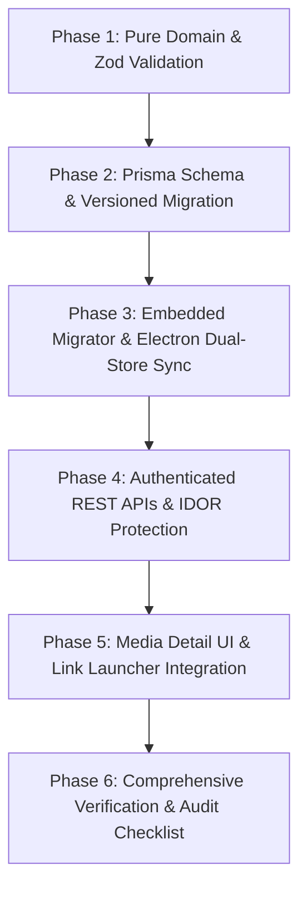

# MLocker — Milestone 4 Implementation Readiness Review & Implementation Plan

**Date:** November 20, 2026  
**Auditor / Agent:** Antigravity  
**Repository:** `AryanTechie-007/MLocker`  
**Branch:** `main`  
**Target Milestone:** Milestone 4 — External Source Manager & Link Launcher  
**Status:** **READY FOR IMPLEMENTATION** (Milestone 3 Formally Approved)  

---

## 1. Executive Summary & Authorization Context

On November 20, 2026, the user formally reviewed, accepted, and approved **Milestone 3 — Six Media Categories** as complete and authorized **Milestone 4 — External Source Manager & Link Launcher** to commence.

This document establishes the architectural design, security boundaries, database migration strategy, testing suite requirements, and step-by-step implementation phases for Milestone 4 in accordance with `AGENTS.md`, `implementation-plan.md`, and `.agents/skills/secure-development/SKILL.md`.

---

## 2. Requirements & Scope Breakdown

### 2.1 Core Functional Requirements
1. **Source Registration:**
   - Users can attach multiple external source destinations to any `UserMedia` item in their library (e.g. Netflix, Crunchyroll, Steam, MangaDex, Open Library, Kindle, personal stream).
   - Each source contains a user-defined display name (e.g., "Crunchyroll"), destination URL (e.g., `https://www.crunchyroll.com/series/G6NQ5DWZ6/attack-on-titan`), normalized domain (`crunchyroll.com`), and source type category (`stream`, `reader`, `game`, `store`, `web`).
2. **URL Validation & Normalization:**
   - Strict protocol enforcement: only `http:` and `https:` schemes are accepted.
   - Rejection of unsafe schemes: `javascript:`, `file:`, `data:`, `blob:`, `smb:`, or custom operating system protocols.
   - Automatic extraction of lowercase canonical domain (`normalizedDomain`, stripping `www.`) for future Milestone 5/6 extension matching.
3. **Safe Link Launching:**
   - **Web:** Direct links open in a new tab with hardened attributes (`target="_blank" rel="noopener noreferrer"`).
   - **Desktop (Electron):** External launch delegates through the hardened IPC bridge (`open-external` -> `handleOpenExternal`) to the OS default browser via `shell.openExternal`. No untrusted external page is ever loaded inside the Electron window.
4. **Full CRUD Operations:**
   - List sources for a media item.
   - Create a source for a media item.
   - Update a source's name, URL, or type.
   - Delete a source.
   - Cascade deletion: deleting a `UserMedia` item automatically cascades to delete all attached `MediaSource` records.
5. **UI & User Experience:**
   - "External Sources" hub on the Media Detail page (`/media/[id]`).
   - Clean badges displaying source name, domain, and quick launch buttons.
   - Add/Edit modal dialog with live URL protocol validation and normalized domain preview.
   - Confirm dialog for source deletion.

---

## 3. Architecture & Security Analysis

### 3.1 Strict Tenant Isolation (Zero Trust & IDOR Prevention)
- **Unauthenticated Enforcement:** All source endpoints (`/api/media/[id]/sources`, `/api/sources/[id]`) must reject unauthenticated requests with HTTP 401 Unauthorized (`code: "UNAUTHORIZED"`).
- **Parent-Child Ownership Verification:**
  - Creating a source requires verifying that the target `UserMedia` record belongs to `session.userId`:
    ```typescript
    const mediaItem = await prisma.userMedia.findFirst({
      where: { id: mediaId, userId: session.userId },
      select: { id: true }
    });
    if (!mediaItem) {
      return NextResponse.json({ error: "Media item not found or access denied", code: "NOT_FOUND" }, { status: 404 });
    }
    ```
  - Mutating or deleting a source requires verifying that the source belongs to a `UserMedia` record owned by `session.userId`:
    ```typescript
    const source = await prisma.mediaSource.findFirst({
      where: {
        id: sourceId,
        userMedia: { userId: session.userId }
      },
      select: { id: true, userMediaId: true }
    });
    if (!source) {
      return NextResponse.json({ error: "Source not found or access denied", code: "NOT_FOUND" }, { status: 404 });
    }
    ```
- **Information Leakage Prevention:** Returns HTTP 404 rather than HTTP 403 on IDOR attempts to avoid leaking the existence of other users' resource IDs.

### 3.2 URL Validation & Injection Prevention
- Input validation in pure domain (`src/lib/domain/validation.ts`):
  ```typescript
  export const SourceUrlSchema = z
    .string()
    .trim()
    .min(1, "URL is required")
    .max(2000, "URL exceeds maximum length")
    .refine((url) => {
      try {
        const parsed = new URL(url);
        return parsed.protocol === "http:" || parsed.protocol === "https:";
      } catch {
        return false;
      }
    }, { message: "Only valid http:// and https:// URLs are permitted" });
  ```
- Domain normalization utility (`src/lib/domain/source-domain.ts`):
  - Pure domain function with zero framework imports.
  - Safely extracts `hostname`, normalizes to lowercase, removes trailing dots and leading `www.`.
  - Rejects hostnames without valid structure.

### 3.3 Electron Security Integrity
- Electron main process already features `handleOpenExternal(shell, url)` in `electron/ipc-handlers.js` with 20 security tests.
- Renderer interacts strictly via `window.electron.openExternal(url)` exposed in `electron/preload.js`.
- No raw IPC channels, shell execution, or Node APIs are exposed.

---

## 4. Database Engineering & Migration Strategy

### 4.1 Schema Definition (`prisma/schema.prisma`)
Add `MediaSource` model and relate it to `UserMedia`:

```prisma
model UserMedia {
  // Existing fields ...
  sources         MediaSource[]
}

model MediaSource {
  id               String     @id @default(cuid())
  userMediaId      String
  userMedia        UserMedia  @relation(fields: [userMediaId], references: [id], onDelete: Cascade)
  name             String
  url              String
  normalizedDomain String
  sourceType       String     @default("web") // "stream", "reader", "game", "store", "web"
  createdAt        DateTime   @default(now())
  updatedAt        DateTime   @updatedAt

  @@index([userMediaId])
  @@index([normalizedDomain])
}
```

### 4.2 SQLite DDL & Prisma Migration
Migration path: `prisma/migrations/20261120000000_media_source/migration.sql`:
```sql
-- CreateTable
CREATE TABLE "MediaSource" (
    "id" TEXT NOT NULL PRIMARY KEY,
    "userMediaId" TEXT NOT NULL,
    "name" TEXT NOT NULL,
    "url" TEXT NOT NULL,
    "normalizedDomain" TEXT NOT NULL,
    "sourceType" TEXT NOT NULL DEFAULT 'web',
    "createdAt" DATETIME NOT NULL DEFAULT CURRENT_TIMESTAMP,
    "updatedAt" DATETIME NOT NULL,
    CONSTRAINT "MediaSource_userMediaId_fkey" FOREIGN KEY ("userMediaId") REFERENCES "UserMedia" ("id") ON DELETE CASCADE ON UPDATE CASCADE
);

-- CreateIndex
CREATE INDEX "MediaSource_userMediaId_idx" ON "MediaSource"("userMediaId");

-- CreateIndex
CREATE INDEX "MediaSource_normalizedDomain_idx" ON "MediaSource"("normalizedDomain");
```

### 4.3 Desktop Embedded Migration Registry Sync (`electron/database/migrations.js`)
In Milestone 2.1, single-source migration consistency was established. Adding version 2 requires:
1. Registering migration `2` in `electron/database/migrations.js`:
   - `version: 2`
   - `name: "20261120000000_media_source"`
   - `sql: resolveMigrationSql("20261120000000_media_source")`
   - Authentic SHA-256 checksum matching Prisma CLI format.
2. Updating `LATEST_SCHEMA_VERSION = 2`.
3. Verifying that `runMigrations(db)` in `electron/database/migrator.js` cleanly upgrades existing v1 databases to v2 while preserving all existing `User`, `UserMedia`, `Collection`, and `CollectionItem` rows.

---

## 5. Phased Implementation Plan



### Phase 1: Pure Domain Logic & Validation
- Create `src/lib/domain/source-domain.ts`:
  - `extractNormalizedDomain(url: string): string`
  - `isValidSourceUrl(url: string): boolean`
  - `detectSourceType(domain: string): string`
- Update `src/lib/domain/validation.ts`:
  - `CreateMediaSourceSchema`
  - `UpdateMediaSourceSchema`
- Write comprehensive unit tests in `tests/unit/source-domain.test.ts`.

### Phase 2: Prisma Schema & Versioned Migration
- Update `prisma/schema.prisma` with `MediaSource` model and relation on `UserMedia`.
- Generate Prisma client: `npx prisma generate`.
- Create canonical migration `prisma/migrations/20261120000000_media_source/migration.sql`.
- Run migration on local development database: `npx prisma migrate deploy` or equivalent.

### Phase 3: Desktop Embedded Migrator Registry Sync
- Update `electron/database/migrations.js` to add version 2 migration with authentic SHA-256 checksum.
- Update `LATEST_SCHEMA_VERSION = 2`.
- Update/extend `tests/database/migration-consistency.test.ts` and `tests/database/lifecycle.test.ts` to verify:
  - Fresh databases initialize directly to version 2 with `MediaSource` table.
  - Existing version 1 databases upgrade seamlessly to version 2 without data loss.

### Phase 4: Authenticated REST APIs & IDOR Protection
- Implement `GET /api/media/[id]/sources` (or integrate sources in `GET /api/media/[id]`).
- Implement `POST /api/media/[id]/sources`:
  - Validates `userMediaId` ownership.
  - Validates payload with `CreateMediaSourceSchema`.
  - Calculates `normalizedDomain`.
  - Creates `MediaSource`.
- Implement `PATCH /api/sources/[id]`:
  - Validates source ownership via `userMedia.userId === session.userId`.
  - Updates fields safely.
- Implement `DELETE /api/sources/[id]`:
  - Validates source ownership via `userMedia.userId === session.userId`.
  - Deletes source.
- Create security & tenant isolation tests in `tests/security/source-tenant-isolation.test.ts`:
  - Unauthenticated 401 checks.
  - Cross-user creation IDOR checks.
  - Cross-user update/delete IDOR checks.
  - Malformed and protocol injection rejection tests (`javascript:`, `file:`).

### Phase 5: UI & Link Launcher Integration
- Update `src/app/media/[id]/page.tsx`:
  - Display configured external sources with domain pills and action buttons.
  - Add source modal with live URL validation and domain preview.
  - Launch button triggering safe web link (`window.open` / anchor) or Electron IPC `window.electron.openExternal(url)`.
  - Delete and edit controls with confirmation dialog.
- Add UI contract tests in `tests/unit/ui-source-controls.test.ts`.

### Phase 6: Full Verification & Audit
- Run complete verification suite:
  - `npx tsc --noEmit` (0 errors)
  - `npm run lint` (0 errors)
  - `npm test` (All existing 201 tests + new source tests passing)
  - `npm run build` (Next.js production build passing)
- Document verification findings in `test-results/milestone-4-implementation-report.md`.

---

## 6. Acceptance Criteria

| Criteria | Target Requirement | Verification Method |
| :--- | :--- | :--- |
| **1. Multi-Source Support** | A media item can have zero, one, or multiple user-configured external sources. | API & Database Integration Test |
| **2. Relational Tenant Isolation** | Only the authenticated owner can view, create, edit, or delete external sources for their media items. Cross-user operations are strictly denied (HTTP 404). | Negative IDOR Security Test Suite |
| **3. Protocol Allowlist** | Only valid `http:` and `https:` URLs are accepted. Dangerous schemes (`javascript:`, `file:`, `data:`, `blob:`, custom schemes) are rejected at the domain validation boundary. | Pure Domain Unit Tests |
| **4. Domain Normalization** | URLs are parsed and their hostname is normalized to canonical lowercase (stripping `www.`) for future extension matching. | Unit Tests (`source-domain.test.ts`) |
| **5. Safe External Launching** | Electron opens approved external URLs in the OS default browser via `shell.openExternal`. Web opens links with `target="_blank" rel="noopener noreferrer"`. | Security IPC Tests & UI Tests |
| **6. Database & Migration Invariance** | Version 2 migration applies cleanly on fresh installs and existing v1 databases. Existing data is 100% preserved. Embedded migrator checksum matches Prisma CLI format. | Database Lifecycle & Migration Tests |
| **7. Quality Gates** | Zero TypeScript errors, zero lint warnings, zero test regressions, clean production build. | `tsc`, `lint`, `vitest`, `build` |

---

## 7. Dependencies & Risk Mitigation

1. **Risk:** Schema migration desynchronization between Prisma CLI and Electron embedded migrator.  
   **Mitigation:** Mirror migration SQL in `electron/database/migrations.js` using identical byte-for-byte resolution and genuine SHA-256 checksums, verified via automated consistency tests.
2. **Risk:** Protocol bypass or URL spoofing via encoded characters or malformed hosts.  
   **Mitigation:** Use WHATWG `URL` parser inside pure domain Zod schema, strictly asserting `protocol === "http:" || protocol === "https:"`, rejecting any URL where parsing throws.
3. **Risk:** Waterfall loading of sources degrading Media Detail page performance.  
   **Mitigation:** Include `sources: true` directly in the existing `GET /api/media/[id]` query, avoiding secondary network requests.

---

## 8. Readiness Conclusion

Milestone 4 requirements are clear, dependencies and security vectors are mapped, and architectural boundaries are defined. Implementation can commence with Phase 1 upon confirmation.
