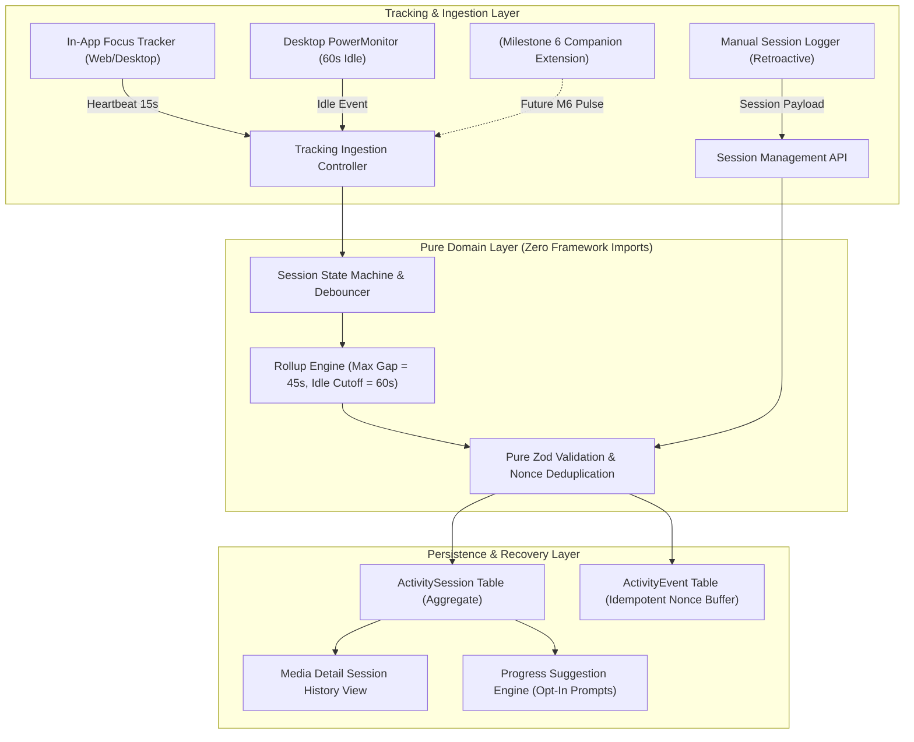
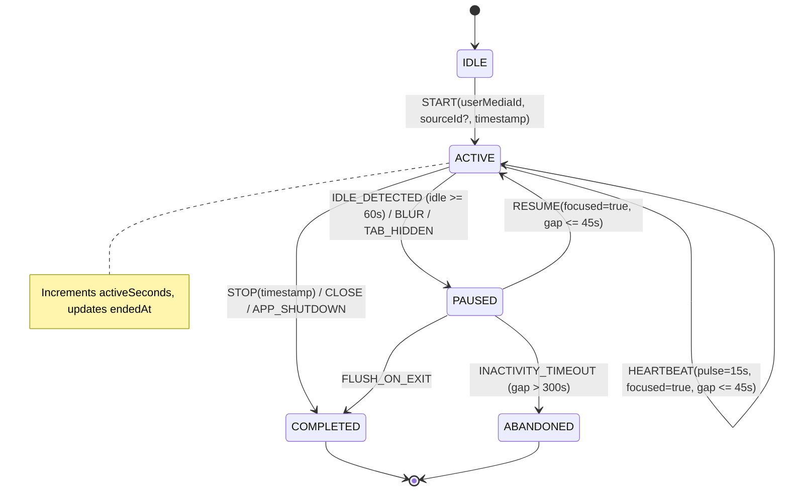

# MLocker — Milestone 5: Session Engine Readiness Review & Implementation Plan

**Milestone:** Milestone 5 — Session Engine & Manual Tracking Foundation  
**Branch:** `feature/milestone-5-session-engine`  
**Base Commit:** `3f89d1ae63e4a9b3a558cdd5e0c3b6a7c2c09109` (from accepted `review/milestone-4-external-sources`)  
**Target Schema Version:** Schema Version 3 (`20261121000000_session_engine`)  
**Status:** **PLANNING & DESIGN REVIEW (Awaiting Project Owner Approval)**  

---

## 1. Goal Description

Build a reliable, privacy-conscious **Session Engine** for MLocker that detects relevant media activity, records consumption sessions, tracks observed activity time, and supports accurate progress updates without falsely claiming that media was watched or read.

Preserve existing web and Electron architecture, six media categories (Movies, TV Shows, Anime, Manga, Games, Books/Novels), database conventions, domain separation, authentication, tenant isolation, and security requirements.

### Core Principles & Philosophical Guarantees:
1. **Observed Active Time ≠ Proof of Watching:** Activity tracking measures observed active engagement on user-approved domains. Never claim verification that a user physically watched every frame or read every word.
2. **Explicit Opt-In Source Matching:** Tracking triggers **only** for user-registered external sources or manual sessions. Never conduct arbitrary or unmapped browsing surveillance.
3. **No Unauthenticated Guest Fallbacks:** All tracking APIs require valid session authentication (`userId = session.userId`). Unauthenticated calls reject with HTTP 401.
4. **Relational Tenant Isolation:** Sessions and events are strictly scoped to the authenticated user. Inter-user IDOR access attempts return HTTP 404 to eliminate existence disclosure.
5. **Separation of Active Time from Progress Units:** Active time accumulation never silently increments episode or chapter progress. Meaningful active duration triggers an explicit user confirmation prompt (*"You were active on Crunchyroll for 24 minutes. Mark Episode 5 as watched (+1 Ep)?"*).
6. **Local-First & Migration Safety:** Local SQLite storage in `app.getPath('userData')` for desktop; zero CLI dependencies in packaged distribution; atomic migration rollback with fail-safe backups. No raw DB sync.

---

## 2. Architecture & Data Flow



---

## 3. Session State Machine & Lifecycle Transitions



### Heuristics & Rules:
- **Pulse Duration:** Default 15 seconds per pulse.
- **Heartbeat Gap Threshold (`MAX_GAP`):** 45 seconds. If `currentTimestamp - session.endedAt <= 45s`, the existing session is extended.
- **Idle Cutoff:** 60 seconds of system or window inactivity automatically halts pulse emissions and transitions to `PAUSED`.
- **Inactivity Timeout:** If a paused session experiences no heartbeat for > 300 seconds (5 minutes), it is closed and sealed.
- **Graceful Shutdown Flush:** Electron app exit triggers `flushOpenSessions()` in `electron/shutdown.js` before closing the database.

---

## 4. User Review Required & Design Decisions

> [!IMPORTANT]
> **Decision 1: How Media Progress Updates Work (User Opt-in vs Automatic)**
> - For **Games** (`mediaType: 'game'`): `hoursPlayed` is the native unit. We propose an opt-in toggle: *"Automatically add active session time to total Hours Played"*.
> - For **Episodes & Chapters** (`tv`, `anime`, `manga`, `novel`): Active time on a webpage is **not** proof that an episode or chapter was completed. We propose a non-intrusive **Progress Prompt / Notification**:
>   *"You were active on Crunchyroll for 24 minutes. Would you like to mark Episode 5 as watched (+1 Ep)?"*
>   The user clicks one button to confirm or dismiss. No episodes or chapters are ever incremented automatically behind the user's back.
> - For **Movies** (`mediaType: 'movie'`): Status remains manual with a completion prompt.

> [!IMPORTANT]
> **Decision 2: ActivityEvent Retention (Lean SQLite Storage)**
> - Continuous 15-second heartbeats would generate ~240 rows per hour. If kept indefinitely, SQLite files would bloat.
> - We propose:
>   - `ActivitySession` is permanent and visible to users in history.
>   - `ActivityEvent` stores raw pulses for active/recent sessions with unique nonces for idempotent deduplication, and is pruned/compacted once sessions are sealed (`COMPLETED`).

> [!TIP]
> **Decision 3: Milestone 5 Tracking Without the Browser Extension**
> - Milestone 5 introduces:
>   1. **In-App Real-Time Session Controller / Focus Timer:** Run tracking directly from MLocker media detail page.
>   2. **"Launch & Track" Workflow:** Clicking "Launch" opens the approved external source and starts an active MLocker tracking session with idle detection.
>   3. **Manual Session Logging:** Retroactive entry with date, start/end time, and notes.
>   4. **Session History & Editing:** Complete historical timeline on `/media/[id]`.
> - Milestone 6 will then introduce the Manifest V3 Chromium companion extension to emit heartbeats automatically from external browser tabs.

---

## 5. Data Model & Migration Design (Schema Version 3)

### 5.1 Prisma Schema Additions (`prisma/schema.prisma`)

```prisma
model ActivitySession {
  id              String         @id @default(cuid())
  userId          String
  user            User           @relation(fields: [userId], references: [id], onDelete: Cascade)
  userMediaId     String
  userMedia       UserMedia      @relation(fields: [userMediaId], references: [id], onDelete: Cascade)
  sourceId        String?
  source          MediaSource?   @relation(fields: [sourceId], references: [id], onDelete: SetNull)
  startedAt       DateTime
  endedAt         DateTime
  activeSeconds   Int            @default(0) // Observed active engagement time
  sourceType      String         @default("web") // "web", "desktop", "manual", "extension"
  status          String         @default("completed") // "active", "paused", "completed", "abandoned"
  notes           String?
  progressStart   Int?           // Episode or chapter at start
  progressEnd     Int?           // Episode or chapter at end
  createdAt       DateTime       @default(now())
  updatedAt       DateTime       @updatedAt

  events          ActivityEvent[]

  @@index([userId, userMediaId])
  @@index([userId, startedAt])
  @@index([userMediaId])
  @@index([status])
}

model ActivityEvent {
  id              String           @id @default(cuid())
  userId          String
  user            User             @relation(fields: [userId], references: [id], onDelete: Cascade)
  sessionId       String?
  session         ActivitySession? @relation(fields: [sessionId], references: [id], onDelete: Cascade)
  userMediaId     String
  sourceId        String?
  clientNonce     String           // Strict idempotent deduplication nonce
  eventType       String           @default("HEARTBEAT") // "START", "HEARTBEAT", "PAUSE", "RESUME", "STOP"
  durationSeconds Int              @default(15)
  isFocused       Boolean          @default(true)
  timestamp       DateTime
  createdAt       DateTime         @default(now())

  @@unique([userId, clientNonce])
  @@index([userId, userMediaId])
  @@index([sessionId])
  @@index([timestamp])
}
```

### 5.2 Canonical DDL Migration (`prisma/migrations/20261121000000_session_engine/migration.sql`)
- Creates `ActivitySession` and `ActivityEvent` tables with `ON DELETE CASCADE` foreign keys and indexes.
- Authentic SHA-256 registered in `electron/database/migrations.js` as version 3.
- Desktop migrator `LATEST_SCHEMA_VERSION = 3`.

---

## 6. Privacy & Security Threat Analysis

| Threat / Risk | Countermeasure | Verification Strategy |
| :--- | :--- | :--- |
| **Surveillance / General Browsing Tracking** | Explicit opt-in source matching only. No general browsing history, DOM contents, keystrokes, form fields, or media streams captured. | Unit & security tests verifying that URLs not matching registered sources are ignored. |
| **Cross-User Session IDOR** | All queries and mutations verify `userId === session.userId`. Linking `userMediaId` or `sourceId` verifies ownership of both items before joining. Cross-user access returns HTTP 404. | 16 tenant isolation negative tests with cross-user tokens. |
| **Replay Attacks / Duplicate Heartbeats** | `@@unique([userId, clientNonce])` on `ActivityEvent`. Ingesting the same nonce twice returns HTTP 200 with idempotent acknowledgment without incrementing duration. | Unit tests sending duplicate nonces concurrently. |
| **Clock Skew & Negative Durations** | Pure domain schema requires `durationSeconds >= 0`, `timestamp >= startedAt`. Pulses with invalid or negative timestamps are rejected. | Pure domain unit tests with reversed/negative timestamps. |
| **Inflated Time Injection** | Individual heartbeat pulses capped at 60 seconds max. Sessions longer than 12 hours without heartbeat auto-close. | Validation schema bounds testing. |
| **Global Emergency Stop** | Instant master toggle (`POST /api/tracking/toggle`) to immediately suspend all active tracking and heartbeat ingestion. | Test master toggle immediately stops session updates. |

---

## 7. Proposed Six-Phase Implementation Breakdown

### Phase 1: Pure Domain Session Logic & Validation
- **Files:** `src/lib/domain/session-engine.ts`, `src/lib/domain/validation.ts`.
- **Scope:** State machine transitions, debouncer heuristics, rollup accumulator, nonce deduplication, and Zod schemas with zero framework imports.
- **Verification:** Comprehensive Vitest unit tests in `tests/unit/session-engine.test.ts` (state transitions, idle cutoffs, time rollups, duplicate nonces).

### Phase 2: Database Models & Canonical Migration
- **Files:** `prisma/schema.prisma`, `prisma/migrations/20261121000000_session_engine/migration.sql`.
- **Scope:** Define `ActivitySession` and `ActivityEvent`, generate canonical migration SQL with cascade relations and indexes.
- **Verification:** Prisma schema validation, migration lint, SQLite DDL syntax validation.

### Phase 3: Desktop Migrator Registry & Lifecycle Integration
- **Files:** `electron/database/migrations.js`, `electron/shutdown.js`.
- **Scope:** Register migration 3 with authentic SHA-256 checksum, bump `LATEST_SCHEMA_VERSION = 3`, implement graceful shutdown session flush.
- **Verification:** `tests/database/lifecycle.test.ts`, `tests/database/migration-consistency.test.ts`, `tests/database/legacy-compatibility.test.ts` (fresh install, v1->v3, v2->v3, legacy upgrades).

### Phase 4: Authenticated REST APIs & Ingestion Pipeline
- **Files:** `src/app/api/sessions/heartbeat/route.ts`, `src/app/api/sessions/route.ts`, `src/app/api/media/[id]/sessions/route.ts`, `src/app/api/sessions/[id]/route.ts`, `src/app/api/tracking/route.ts`.
- **Scope:** Endpoints for heartbeat ingestion, session CRUD, manual logging, and global privacy toggle with strict tenant isolation.
- **Verification:** `tests/security/session-tenant-isolation.test.ts` (unauthenticated 401, cross-user 404, valid CRUD 200/201).

### Phase 5: UI Session History, In-App Tracker & Progress Prompts
- **Files:** `src/components/SessionHistory.tsx`, `src/components/ActiveSessionTracker.tsx`, `src/components/ManualSessionModal.tsx`, `src/app/media/[id]/page.tsx`.
- **Scope:** Real-time focus session controller, interactive timeline history on media detail page, manual session creation/edit modal, and non-intrusive progress prompt dialog.
- **Verification:** `tests/unit/ui-session-controls.test.ts`, modal state reset verification, manual UI testing.

### Phase 6: Comprehensive Quality Gates & Multi-Platform CI
- **Files:** `.github/workflows/ci.yml`.
- **Scope:** Update packaged runtime verification to expect `PRAGMA user_version = 3` and required tables `['ActivitySession', 'ActivityEvent']`. Run full test suite, lint, typecheck, Next.js build.
- **Verification:** `npx tsc --noEmit` (0 errors), `npm run lint` (0 errors), `npm test` (all tests passing), remote GitHub Actions CI green on Linux and Windows.

---

## 8. Verification Plan

### Automated Tests:
- `npx tsc --noEmit`
- `npm run lint`
- `npm test` (existing 295 tests + ~80 new session tests across unit, database, security, and UI)
- `npm run build`

### Manual Verification:
1. Open media detail page (`/media/[id]`), launch an external source with session tracking enabled.
2. Observe active time accumulator incrementing.
3. Simulate idle for 60 seconds; verify timer pauses.
4. Stop session; verify session record appears in historical timeline with correct duration.
5. Verify progress prompt appears asking whether to increment episode/chapter, and updates progress only upon explicit confirmation.
6. Verify manual session addition, editing, and deletion.
7. Test global privacy toggle immediately stops tracking.
